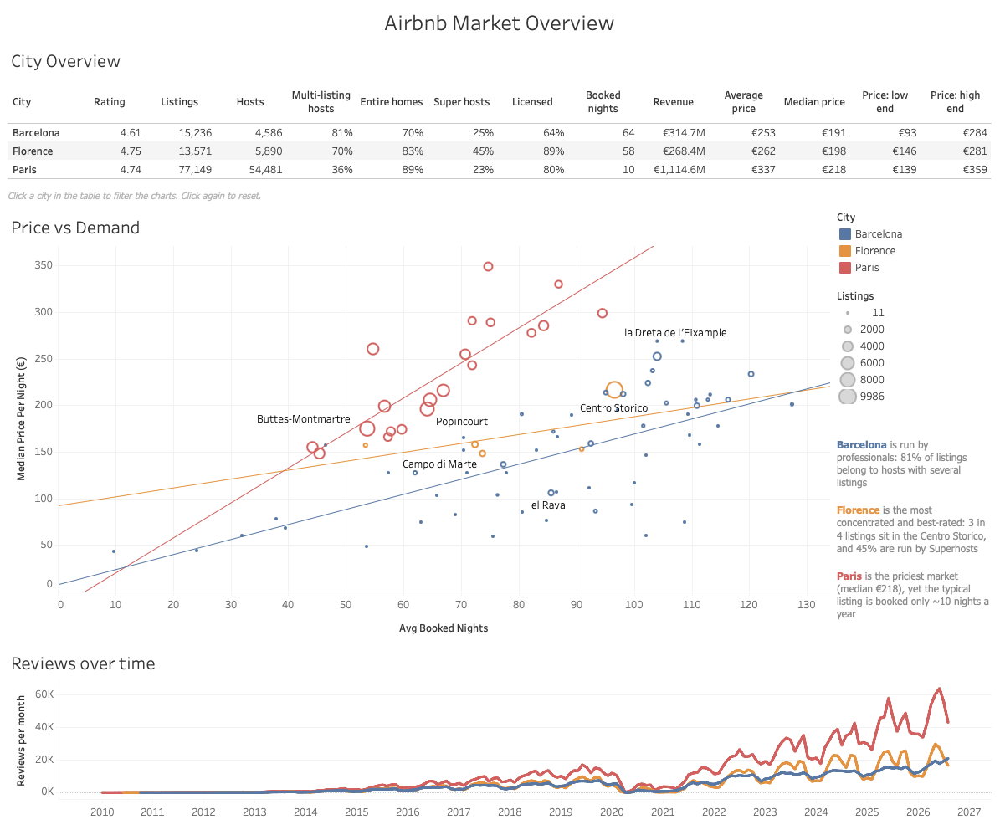
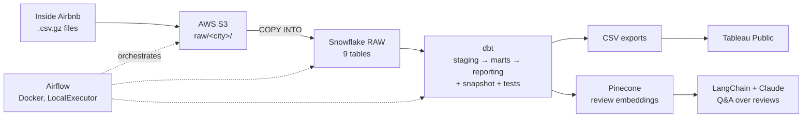

# Hospitality Data Pipeline: Short-Term Rentals in Paris, Barcelona & Florence

An end-to-end data engineering project on public [Inside Airbnb](https://insideairbnb.com/) data for three European cities: raw files land in **AWS S3**, are loaded into **Snowflake**, modelled and tested with **dbt**, orchestrated by **Airflow** and presented in a **Tableau Public** dashboard. A small **RAG** layer (Pinecone + LangChain + Claude) answers questions about guest reviews.

## Dashboard



**[View the interactive dashboard on Tableau Public](https://public.tableau.com/views/Finaldashboard_17939510665140/AirbnbMarketOverview)**

Click a city in the table to filter the charts; click a city in the legend to highlight it.

**Key findings**
- **Paris** is the priciest market (median €218 per night), yet the typical listing is booked only about 10 nights a year: many listings are homes rented out occasionally.
- **Barcelona** is run by professionals: 81% of listings belong to hosts with several listings.
- **Florence** is the most concentrated and best-rated market: 3 in 4 listings are in the Centro Storico, and 45% are run by Superhosts.

## Architecture



The pipeline is **ELT**: data is loaded into Snowflake unchanged, and all transformations happen inside the warehouse with dbt.

## Tech stack

| Layer | Tools |
|---|---|
| Storage | AWS S3 (versioning + lifecycle rules) |
| Warehouse | Snowflake (key-pair authentication) |
| Transformation | dbt (dbt-snowflake), dbt_utils |
| Orchestration | Apache Airflow in Docker Compose (LocalExecutor) |
| Visualisation | Tableau Public |
| AI layer | Pinecone (integrated embedding, llama-text-embed-v2), LangChain, Claude |
| Language | Python 3, SQL |

## Data model

| Layer | Models | Grain | Materialisation |
|---|---|---|---|
| Staging | `stg_airbnb__listings`, `stg_airbnb__calendar`, `stg_airbnb__reviews` | one row per source row, all cities unioned | view |
| Marts | `dim_listings` | listing | table |
| | `fct_calendar` | listing × date | table |
| | `fct_reviews` | review × listing (hotels share reviews across room listings) | table |
| Reporting | `rpt_city_summary` | city | table |
| | `rpt_neighbourhood_summary` | city × neighbourhood | table |
| | `rpt_city_monthly` | city × month | table |
| Snapshot | `scd_raw_listings` | listing × validity period (SCD type 2) | snapshot |

All three cities are handled by one set of models: the city list lives in a dbt variable (`vars: cities`), and the macro `union_city_sources` unions the per-city raw tables and adds a `city` column. Adding a city means adding it to the list and loading its files.

## Data quality

- **Load checks:** the extract fails if any expected file is missing and verifies each upload's size in S3; the loader checks every `COPY INTO` status and reconciles the table's row count with the rows loaded.
- **dbt tests:** uniqueness and not-null on keys, `unique_combination_of_columns` on composite grains, `accepted_values` on `city`.
- **Singular tests:** every configured city is present; the city summary reconciles with staging (same number of listings per city).

## Project structure

```
hospitality-de-pipeline/
├── dags/                  # Airflow DAG
├── src/
│   ├── extract_to_s3.py       # local files → S3
│   ├── load_to_snowflake.py   # S3 → Snowflake RAW (full refresh + reconciliation)
│   └── rag/                   # Pinecone loader, semantic search, Q&A with Claude
├── hospitality_dbt/       # dbt project (models, macros, snapshots, tests)
├── docs/                  # screenshots
├── data/                  # raw files (git-ignored)
├── Dockerfile             # Airflow image + dbt-snowflake
└── docker-compose.yaml
```

## How to run

**Prerequisites:** Docker Desktop, Python 3, an AWS account with an S3 bucket, a Snowflake account set up for key-pair authentication, and (for the RAG layer) Pinecone and Anthropic API keys.

1. **Download the data** from [Inside Airbnb](https://insideairbnb.com/get-the-data/) (`listings`, `reviews` and `calendar` for each city) and save the files as:
   ```
   data/<city>/<type>_<city>.csv.gz      e.g. data/paris/listings_paris.csv.gz
   ```
2. **Create a `.env` file** in the project root (never commit it):
   ```
   AWS_ACCESS_KEY_ID=...
   AWS_SECRET_ACCESS_KEY=...
   S3_BUCKET_NAME=...
   SNOWFLAKE_ACCOUNT=...
   SNOWFLAKE_USER=...
   SNOWFLAKE_DATABASE=HOSPITALITY_DB
   SNOWFLAKE_WAREHOUSE=COMPUTE_WH
   SNOWFLAKE_PRIVATE_KEY_PATH=/path/to/rsa_key.p8
   PINECONE_API_KEY=...
   ANTHROPIC_API_KEY=...
   ```
3. **Configure dbt:** add a `hospitality_dbt` profile to `~/.dbt/profiles.yml` that uses `private_key_path: "{{ env_var('SNOWFLAKE_PRIVATE_KEY_PATH') }}"`.
4. **Start Airflow:**
   ```bash
   docker compose --env-file .env up -d --build
   ```
   Open http://localhost:8080 and trigger the DAG. It runs extract → load → dbt → tests.
5. **Optional, the RAG layer:**
   ```bash
   python src/rag/load_reviews_to_pinecone.py
   python src/rag/ask_reviews.py "What do guests complain about most?" --city paris
   ```

## Decisions and limitations

The reasoning behind the main design choices, and the known limitations of the data, are documented in **[DECISIONS.md](DECISIONS.md)**. The most important limitation: the reviews only cover listings that still existed at the time of the snapshot, so historical demand is undercounted, and the review time series should be read for seasonality, not long-term growth.

## Data source and licence

Data: [Inside Airbnb](https://insideairbnb.com/), snapshot from September 2026, used under the [Creative Commons Attribution 4.0](https://creativecommons.org/licenses/by/4.0/) licence. Reviewer names are dropped in staging and never reach the models or the dashboard.
